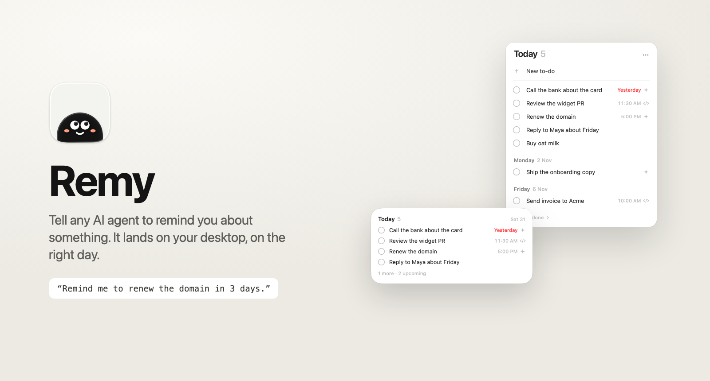
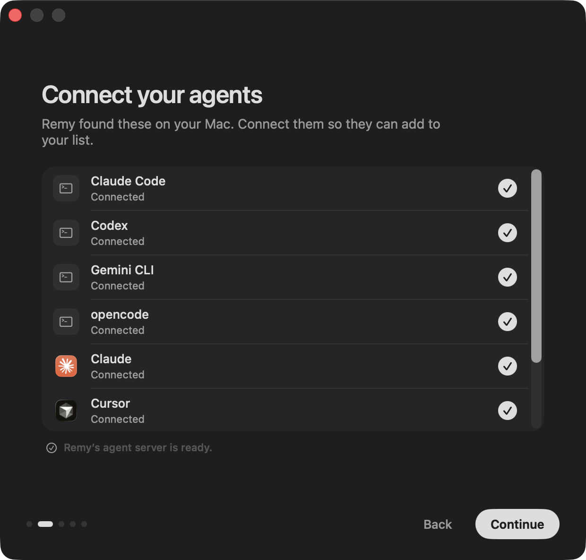
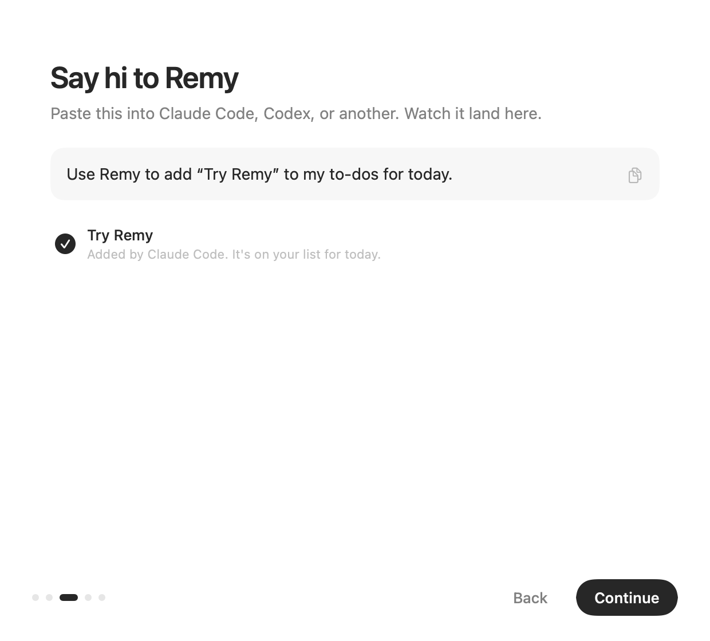
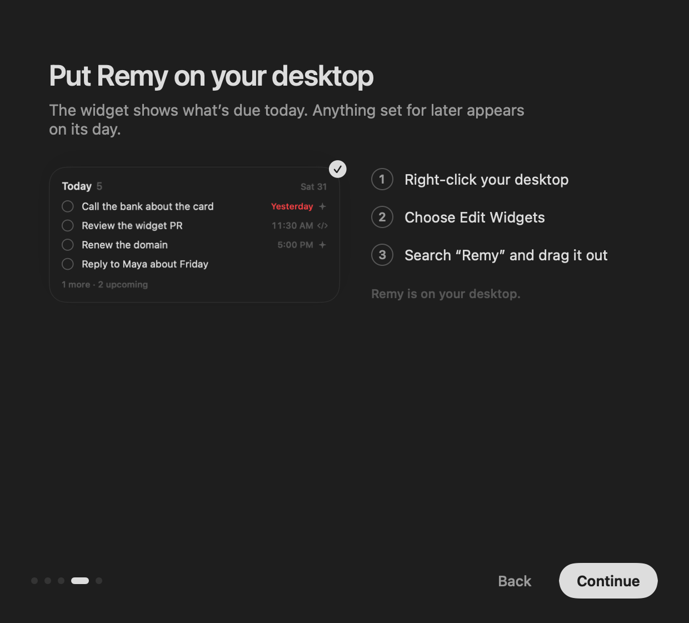
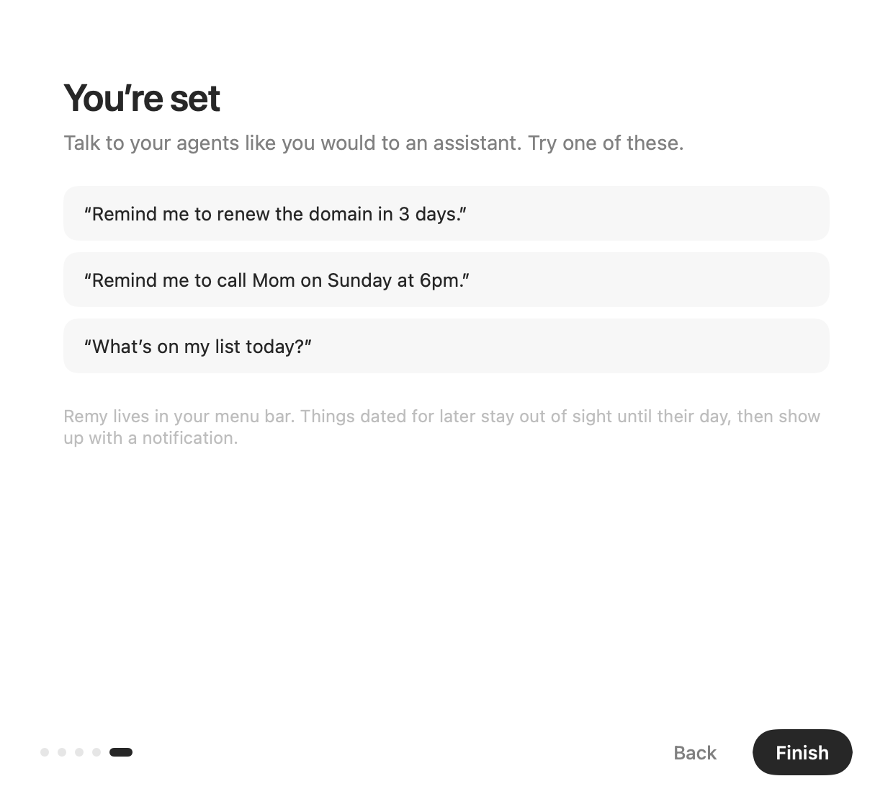
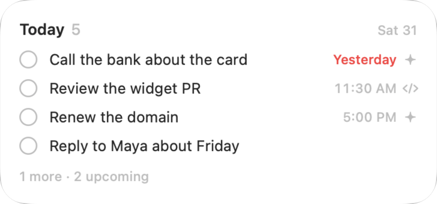
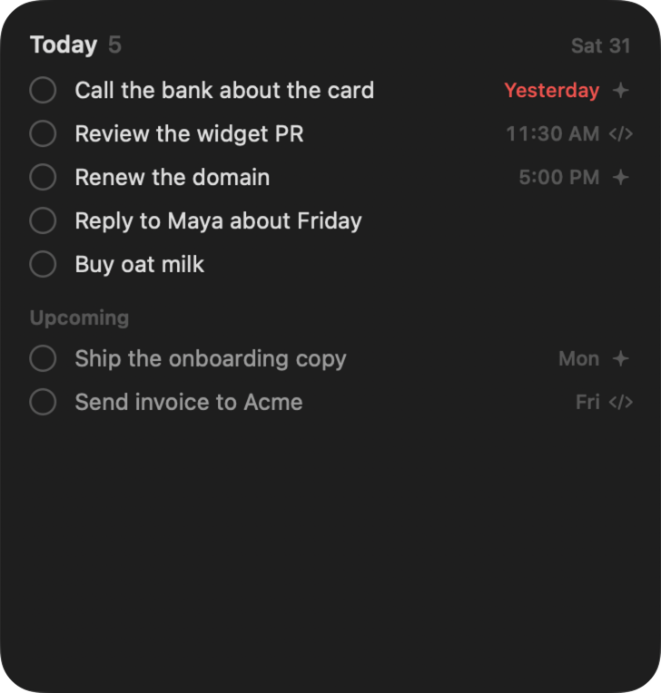
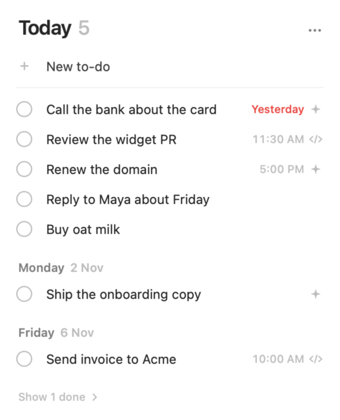
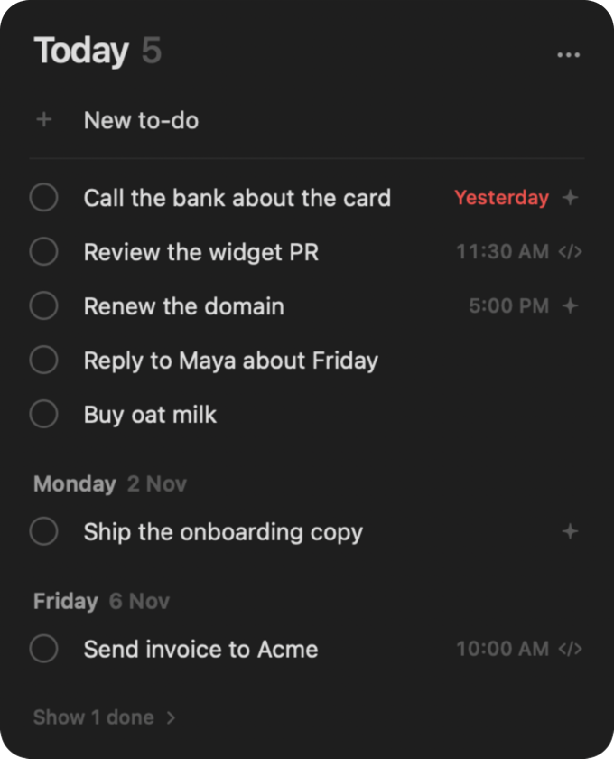
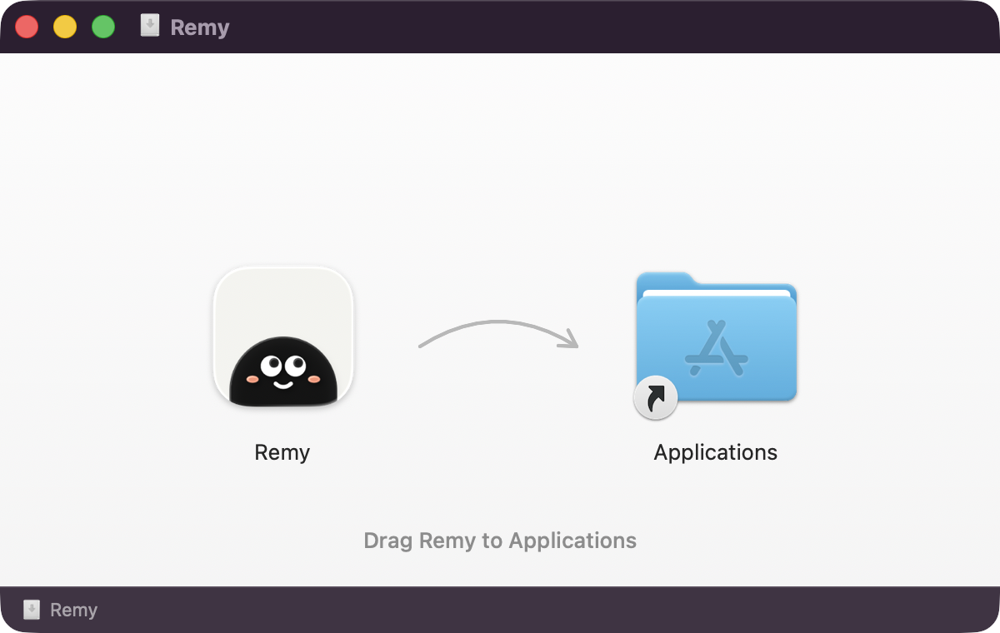

<p align="center">
  
</p>

<p align="center">
  <b>Tell any AI agent to remind you about something. It lands on your desktop, on the right day.</b>
</p>

<p align="center">
  <a href="https://github.com/Deveshb15/remy/releases/latest/download/Remy.dmg"><b>Download for macOS</b></a>
  &nbsp;·&nbsp; macOS 26 Tahoe or later &nbsp;·&nbsp; Apple silicon and Intel &nbsp;·&nbsp; Notarized by Apple
</p>

---

Remy is a quiet little to-do widget for the Mac that your agents can write to. Tell Claude Code, Codex, Cursor, or any agent *"remind me to renew the domain in 3 days"*. Remy keeps the to-do out of sight until that day, then it appears on your desktop with a notification.

- **Works with the agents you already use.** Remy connects to Claude Code, Codex, Gemini CLI, opencode, Claude, Cursor, Windsurf, VS Code, and LM Studio in one click. Any other agent can use MCP or the `remy` command line.
- **Dated, not dumped.** Future to-dos stay hidden until their day. Overdue ones float to the top in red. Nothing else on the widget uses color.
- **A widget worth keeping on your desktop.** Small, medium, and large, with check-off right on the widget.
- **Local and private.** Your list is a JSON file on your Mac. Remy has no account, no cloud, and no network calls.

## How it works

<table>
<tr>
<td width="50%"></td>
<td width="50%"></td>
</tr>
<tr>
<td><b>1. Connect your agents.</b> Remy finds the agents installed on your Mac and adds itself as a tool. Every settings file it touches is backed up first.</td>
<td><b>2. Say hi.</b> Paste the suggested prompt into any agent and watch the to-do arrive. That proves the connection end to end.</td>
</tr>
<tr>
<td></td>
<td></td>
</tr>
<tr>
<td><b>3. Put Remy on your desktop.</b> Add the widget. Remy notices once it's placed.</td>
<td><b>4. Talk to it like an assistant.</b> Dates such as "in 3 days" or "Sunday at 6pm" resolve in your local time zone, and your agent repeats the date back so you can catch mistakes.</td>
</tr>
</table>

## The widget

<p align="center">
  
  
</p>
<p align="center">
  
</p>

Hairline checkboxes, quiet gray times, and a small mark showing which agent added each to-do. Red is used only for overdue items. The large widget fills its spare rows with a dimmed preview of what's coming. You can check things off right on the widget.

## The menu bar

<p align="center">
  
  &nbsp;&nbsp;
  
</p>

Click Remy's face in the menu bar to see today, upcoming days, and what's done. Remy keeps itself up to date: it checks for updates once a day, or any time from **… → Check for Updates…**. Type to add a to-do, and date options appear as you type. Right-click a to-do to reschedule or delete it. Checking one off gives a small spring, a ripple, and a line drawn through it. Click again within a moment to undo.

## Install

1. [Download Remy.dmg](https://github.com/Deveshb15/remy/releases/latest/download/Remy.dmg).
2. Drag Remy to Applications and open it.
3. Follow the short setup.

<p align="center"></p>

To run the setup again later, choose **… → Connect Agents…** in the popover, or run `open remy://connect`.

## Talking to Remy

Ask your agent in plain words:

> Remind me to renew the domain in 3 days.
> Add "call Mom" for Sunday at 6pm.
> What's on my list today?
> Move the invoice to next Monday.

Agents see six MCP tools: `add_todo`, `list_todos`, `update_todo`, `complete_todo`, `delete_todo`, and `current_time`. Every response includes the current local date, so phrases like "next Friday" resolve correctly. Every write echoes the resolved date in plain words, for example "Fri, Nov 6 · 10:00 AM".

### Command line

The same actions are available as a command, for scripts and agents without MCP:

```sh
ln -sf /Applications/Remy.app/Contents/Helpers/remy ~/.local/bin/remy

remy add "Renew the domain" --date 2026-11-03 --time 17:00
remy list            # today (overdue first) · also: upcoming, done, all
remy done <id>       # or: undo, rm, edit <id> --date … --no-time
```

### Connecting an agent by hand

Onboarding does this for you. If you need to do it yourself:

```sh
claude mcp add --scope user remy -- /Applications/Remy.app/Contents/Helpers/remy mcp
codex mcp add remy -- /Applications/Remy.app/Contents/Helpers/remy mcp
```

For any other MCP client:

```json
{ "mcpServers": { "remy": { "command": "/Applications/Remy.app/Contents/Helpers/remy", "args": ["mcp"] } } }
```

## Privacy

Remy has no account, no analytics, and no server. To-dos live in a single JSON file in Remy's app group container on your Mac. Agents reach the running app through a Unix socket that only your user account can access. When Remy edits an agent's settings file, it saves a `.remy-backup` copy first. It never rewrites a file it can't parse safely, such as JSON with comments.

## Build from source

You need macOS 26, Xcode 26, [XcodeGen](https://github.com/yonaskolb/XcodeGen), and [uv](https://github.com/astral-sh/uv). The DMG layout runs `uvx dmgbuild`.

```sh
./scripts/make-dmg.sh                                   # build/Remy.dmg
REMY_NOTARY_PROFILE=<notarytool profile> ./scripts/make-dmg.sh   # + notarize and staple
```

Signing uses `DEVELOPMENT_TEAM` in `project.yml`. If a **Developer ID Application** certificate for that team is in your keychain, the script builds a Developer ID release. It signs the app, widget, CLI, and the DMG itself. With a notary profile, it notarizes and staples the app and then the DMG. Without the certificate, it builds a development DMG that runs only on your own Mac.

**Shipping updates:** Remy updates itself with [Sparkle](https://sparkle-project.org). To publish one, run `scripts/release.sh <version> <notes.md>`. It builds, notarizes, signs, publishes the GitHub release, and updates `appcast.xml`. The full process, and when to ship what, is in [docs/releasing.md](docs/releasing.md).

To run the tests:

```sh
cd Packages/RemyKit && swift test
```

For design work, the `Snapshots` scheme renders every surface (popover, widget sizes, onboarding steps) to PNG in light and dark mode.

### Layout

| Path | What it is |
|---|---|
| `Packages/RemyKit` | Model, JSON store, date logic, wire protocol, CLI parsing, harness catalog. Fully unit-tested. |
| `App/` | The menu bar app. It is the only writer, and owns the socket, notifications, and widget reloads. |
| `App/Onboarding/` | First-run flow: move to Applications, detect, connect, and verify agents, then add the widget. |
| `Widget/` | The WidgetKit extension, with interactive check-off. |
| `CLI/` | The `remy` binary (command line + stdio MCP server), embedded in `Remy.app/Contents/Helpers`. |
| `App/AppIcon.icon` | The Liquid Glass app icon (Icon Composer format). Layers come from `scripts/generate-icon.swift`. |
| `design/`, `docs/` | Logo explorations, the visual and motion spec, requirements, and plans. |

## Uninstall

Quit Remy and move it to the Trash. To disconnect your agents first, run `claude mcp remove remy --scope user` and `codex mcp remove remy`. For other agents, delete the `remy` entry from their MCP settings.

<p align="center"></p>
