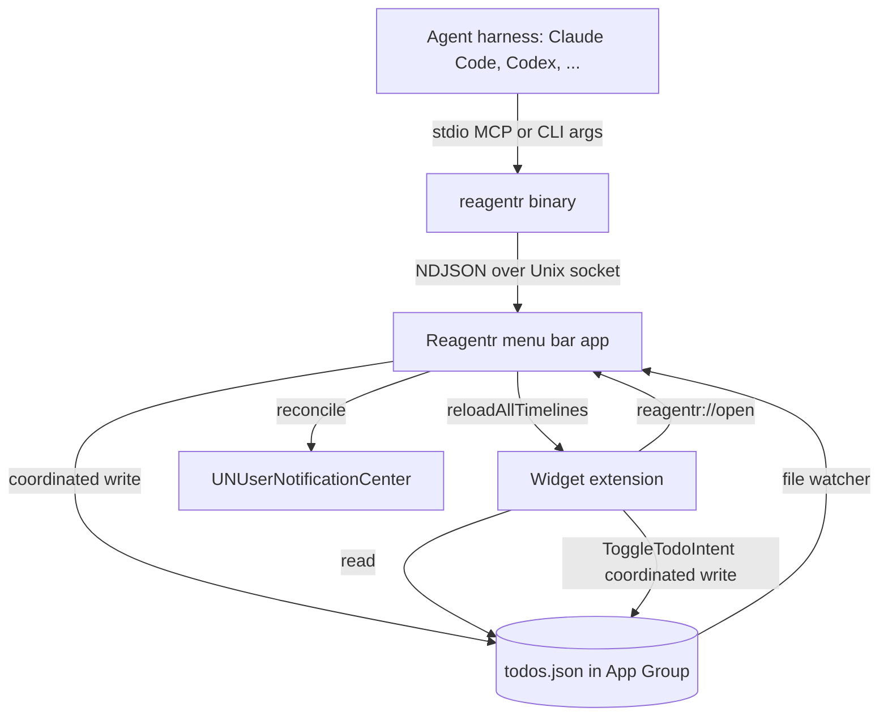
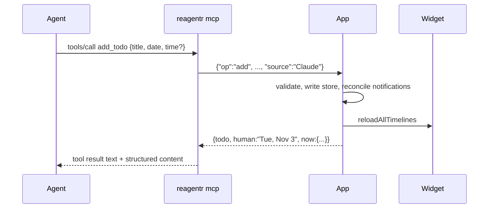
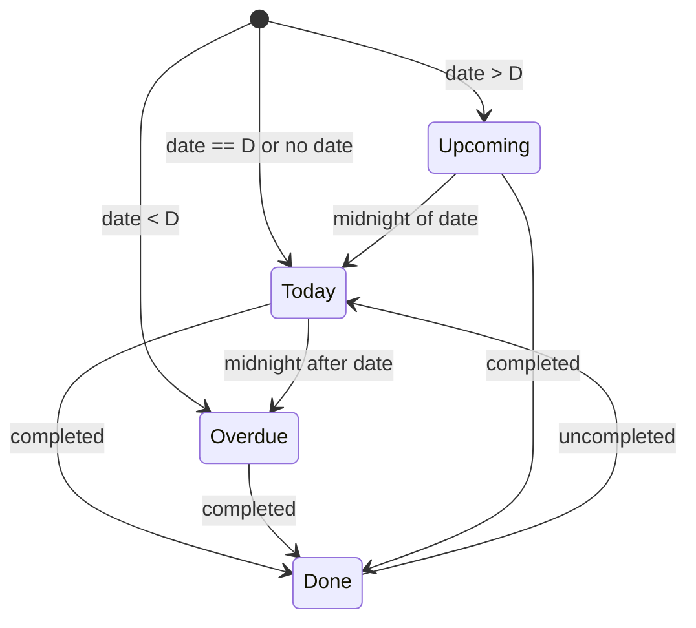

# feat: Reagentr — agent-fed to-do widget for macOS

## Summary

Build a native macOS 26 app with three parts: a menu bar app that owns the to-do store, a WidgetKit desktop widget, and an embedded `reagentr` binary that serves both a CLI and a stdio MCP server. Agents talk to `reagentr`, `reagentr` talks to the running app over a Unix socket, and the app writes the store, refreshes the widget, and schedules notifications.

---

## Problem Frame

Greenfield project in an empty repo. The product behavior is fixed by the origin doc (see origin: docs/brainstorms/2026-10-31-agent-todo-widget-requirements.md). This plan decides how the processes share data and how future-dated to-dos reach the widget without the app being opened.

---

## Requirements

Carried from origin. R-IDs match the origin doc.

**Dated to-dos:** R1 to-do fields; R2 undated means today; R3 hidden until its day; R4 notification at its time or 9:00 AM; R5 overdue stays and sorts first; R6 done leaves the widget and appears in the Done list.

**Agent interface:** R7 add, list, complete, reschedule, edit, delete; R8 today, upcoming, and done views; R9 MCP plus CLI parity; R10 every write echoes the resolved date; R11 the agent learns the current date, time, and timezone; R12 widget reflects changes within seconds; R13 one-snippet setup.

**Widget:** R14 small, medium, and large sizes; R15 check off in place; R16 row anatomy; R17 delightful empty state; R18 click opens the popover; R19 light, dark, tinted, and clear modes.

**Popover:** R20 Today, Upcoming, and Done; R21 quick-add with chips; R22 manage to-dos; R23 setup instructions.

**Delight:** R24 check-off moment; R25 springy list motion; R26 design skill and Mobbin references; R27 Reduce Motion honored.

Origin actors A1 (you), A2 (agent), and A3 (app); flows F1 to F3; and acceptance examples AE1 to AE5 carry forward and are linked from the units below.

---

## Key Technical Decisions

- **macOS 26 only, Swift 6, SwiftUI.** The user's Mac runs 26.6 with Xcode 26.5. Targeting only this version unlocks Liquid Glass and current WidgetKit rendering modes with no fallback code.
- **XcodeGen project (`project.yml`).** XcodeGen is already installed, and keeps the multi-target project reproducible from text without Xcode GUI edits.
- **Shared logic in a local Swift package `ReagentrKit`.** It holds the model, store, schedule, and command handling. All three targets link it, and its logic is tested with Swift Testing using `swift test`, independent of Xcode signing.
- **The app is the single writer for agent and popover changes.** The widget's check-off intent is the only other writer. Both write through `NSFileCoordinator`. One owner keeps widget reloads and notification scheduling in one place.
- **Store is one JSON file in the App Group container.** It's personal-scale data, a few hundred items at most. Codable plus atomic, coordinated writes beats SwiftData's multi-process quirks. The widget extension is sandboxed and can only reach the group container.
- **IPC is a Unix domain socket at `~/Library/Application Support/Reagentr/agent.sock` (mode 0600), via Network.framework.** A socket can't be reached from web pages, unlike a localhost HTTP port, and is user-only. Keeping it outside the group container avoids macOS's "access data from other apps" prompt for the unsigned CLI.
- **Wire protocol is newline-delimited JSON request/response, defined once in ReagentrKit.** CLI and MCP share it, which gives R9 parity for free.
- **Main app is not sandboxed; the widget extension is sandboxed.** Personal build (see origin Key Decisions). This removes socket and file entitlement friction.
- **Dates are stored as floating local values.** A to-do stores a date as `YYYY-MM-DD` and an optional time as `HH:mm`, not an absolute instant. "Nov 3, 5 PM" stays Nov 3, 5 PM after travel, which resolves the origin's timezone question.
- **Agents send absolute dates; every response includes `now`.** `now` carries the local ISO date, weekday, time, and timezone. Writes echo a human string such as "Tue, Nov 3 · 5:00 PM". This covers R10 and R11 without natural-language date parsing.
- **Source badge comes from the MCP `clientInfo.name`.** Names containing "claude" map to Claude and "codex" to Codex; anything else uses the raw name. The CLI uses `--source`, or `REAGENTR_SOURCE`, defaulting to `cli`. Popover adds use `you`.
- **The widget timeline precomputes day boundaries.** Entries are created at now and at each upcoming local midnight that changes what's visible (up to 14), with policy `.after(last)`. Future to-dos then appear without the app running (R3).
- **Notifications are reconciled, not tracked.** After any store change, the app diffs pending `UNUserNotificationCenter` requests against the store and adds or removes the difference. Widget check-offs are picked up by the app's file watcher.
- **The popover is an `NSStatusItem` with an `NSPopover` hosting SwiftUI.** SwiftUI `MenuBarExtra` can't be opened programmatically, and R18 needs the widget click (`reagentr://open`) to open it.
- **`reagentr` launches the app if the socket is absent.** It opens the bundle ID in the background, then retries the connection for up to 5 seconds. The app also registers itself as a login item through `SMAppService.mainApp`.
- **MCP uses the official `modelcontextprotocol/swift-sdk` with stdio transport.** Pin it to the latest release at implementation time. It's the only third-party dependency.

---

## High-Level Technical Design

Component topology:



Agent add flow (F1). This is directional:



To-do visibility on a given day D (drives the widget, the lists, and R3/R5):



---

## Output Structure

```text
project.yml
Packages/ReagentrKit/
  Package.swift
  Sources/ReagentrKit/   Todo.swift, TodoStore.swift, Schedule.swift, Wire.swift, CommandHandler.swift, Paths.swift
  Tests/ReagentrKitTests/ TodoStoreTests.swift, ScheduleTests.swift, CommandHandlerTests.swift, WireTests.swift
App/          ReagentrApp.swift, AppController.swift, StatusItemController.swift, SocketServer.swift, NotificationReconciler.swift, StoreWatcher.swift, Info.plist, App.entitlements
App/UI/       PopoverRoot.swift, TodoRow.swift, QuickAdd.swift, UpcomingList.swift, DoneList.swift, SetupPanel.swift, Celebration.swift, Theme.swift
Widget/       ReagentrWidget.swift, Provider.swift, WidgetViews.swift, ToggleTodoIntent.swift, Info.plist, Widget.entitlements
CLI/          main.swift, SocketClient.swift, MCPServer.swift, Launcher.swift
docs/design/visual-spec.md
```

---

## Implementation Units

### U1. Project skeleton and ReagentrKit store

**Goal:** Create a buildable three-target project, plus the core model and a persistent store.

**Requirements:** R1, R2, R6

**Dependencies:** none

**Files:** `project.yml`, `Packages/ReagentrKit/Package.swift`, `Packages/ReagentrKit/Sources/ReagentrKit/Todo.swift`, `Packages/ReagentrKit/Sources/ReagentrKit/TodoStore.swift`, `Packages/ReagentrKit/Sources/ReagentrKit/Paths.swift`, `Packages/ReagentrKit/Tests/ReagentrKitTests/TodoStoreTests.swift`, `App/ReagentrApp.swift`, `App/Info.plist`, `App/App.entitlements`, `Widget/ReagentrWidget.swift`, `Widget/Info.plist`, `Widget/Widget.entitlements`, `CLI/main.swift`, `.gitignore`

**Approach:**
- Targets: `Reagentr` (app, `LSUIElement`), `ReagentrWidget` (widget extension, sandboxed, App Group), and `reagentr` (command-line tool, copied into `Contents/MacOS`). Bundle ID prefix `dev.devesh.reagentr`. The development team is a build setting the user sets once.
- `Todo` fields: `id` (6-char lowercase base32), `title`, `date?`, `time?`, `source`, `createdAt`, `completedAt?`. `date` and `time` are strings validated on decode.
- `TodoStore` loads and saves `todos.json` in the App Group container through `NSFileCoordinator`, writes atomically, and keeps file-level `version: 1`. A missing file means an empty store.
- `Paths` resolves the group container URL and the socket path from one place.

**Test scenarios:**
- Happy path: save three to-dos, reload from disk, and get equal values in the same order.
- Edge case: a missing file loads as an empty store, and a corrupt file is moved aside to `todos.corrupt-<timestamp>.json`. It isn't silently overwritten.
- Edge case: decoding rejects `date: "2026-13-01"` and `time: "25:00"`.
- Edge case: generated IDs are unique across 10k generations within one store.

**Verification:** `swift test` passes for ReagentrKit. XcodeGen generates a project in which all three targets compile.

### U2. Schedule logic

**Goal:** Implement pure functions that decide visibility, ordering, widget timeline boundaries, notification fire dates, and human date strings.

**Requirements:** R2, R3, R4, R5, R6, R10, R14

**Dependencies:** U1

**Files:** `Packages/ReagentrKit/Sources/ReagentrKit/Schedule.swift`, `Packages/ReagentrKit/Tests/ReagentrKitTests/ScheduleTests.swift`

**Approach:**
- `bucket(todo, on: day)` returns `today`, `overdue`, `upcoming`, or `done`, following the visibility state diagram.
- The widget list for a day is overdue (oldest first), then today. Timed items sort by time and come before untimed ones, then by `createdAt`.
- `timelineDates(todos, from: now)` returns now plus each future local midnight at which a to-do's bucket changes, deduplicated and capped at 14.
- `fireDate(todo)` is date + time, or date at 09:00 when there's no time. It returns nil for done, undated, or past items.
- `human(todo, relativeTo:)` produces "Today · 5:00 PM", "Tomorrow", or "Tue, Nov 3 · 5:00 PM", plus a year when it differs from the current year.
- Every function takes `Calendar` and `now` as parameters, so tests never depend on the wall clock.

**Test scenarios:**
- Covers AE1. With today Sat Oct 31, a to-do for Nov 3 is `upcoming` on Oct 31, Nov 1, and Nov 2, and `today` on Nov 3. `timelineDates` from Oct 31 includes Nov 3 00:00.
- Covers AE2. A date-only Nov 3 to-do fires at Nov 3 09:00, and a Nov 3 17:00 to-do fires at 17:00. Both are `today` from Nov 3 00:00.
- Covers AE3. A to-do due Oct 30, not done, is `overdue` on Oct 31 and sorts above today's items.
- Edge case: an undated to-do is `today` on any day (R2).
- Edge case: a done to-do is `done` regardless of date. Un-completing it restores its date-based bucket.
- Edge case: on a DST transition day, the midnight boundary is still correct, tested with the `America/New_York` calendar on 2026-11-01.
- Edge case: `timelineDates` with no future-dated items returns only now plus the next midnight, so the overdue state can flip.
- Happy path: `human` produces "Fri, Nov 6" for next Friday relative to Oct 31 (AE4 support).

**Verification:** All scenarios pass under fixed calendars.

### U3. Wire protocol and command handler

**Goal:** Define the request/response contract and apply it to the store. The CLI, MCP, and popover all share this one code path.

**Requirements:** R7, R8, R10, R11, R1

**Dependencies:** U1, U2

**Files:** `Packages/ReagentrKit/Sources/ReagentrKit/Wire.swift`, `Packages/ReagentrKit/Sources/ReagentrKit/CommandHandler.swift`, `Packages/ReagentrKit/Tests/ReagentrKitTests/CommandHandlerTests.swift`, `Packages/ReagentrKit/Tests/ReagentrKitTests/WireTests.swift`

**Approach:**
- Ops: `add {title, date?, time?, source}`, `list {view: today|upcoming|done|all}`, `update {id, title?, date?, time?, clearDate?, clearTime?}`, `complete {id, done: Bool}`, `delete {id}`, and `now`.
- Each response is `{ok, todo? | todos?, human?, now: {date, weekday, time, timezone}, error?}`. A list item carries its `human` string and `bucket`.
- Validation lives at this trust boundary. An empty or whitespace-only title is rejected, and titles are capped at 200 characters. A `time` without a `date` is rejected with a message telling the agent to send a date. An unknown ID returns `not_found` with a hint to call list.
- A past date on add is allowed and lands as overdue. The response says so, so the agent can correct it.
- The handler takes the store, `now`, and the calendar as injected dependencies, and returns a value plus a `changed: Bool` so the host knows when to reload and reconcile.

**Test scenarios:**
- Covers AE4. `add {title:"Pay rent", date:"2026-11-06"}` with now = Oct 31 returns `human: "Fri, Nov 6"` and a `now.date` of 2026-10-31.
- Happy path: `list today` returns overdue then today items and excludes upcoming. `list upcoming` returns future items grouped by date order.
- Covers AE5 at the handler level. `complete {id, done:true}` followed by `list today` excludes the item, and `list done` includes it.
- Happy path: `update` with `clearDate:true` makes a to-do undated, so it's due today.
- Error path: empty title, an invalid date string, `time` without `date`, and an unknown ID each return `ok:false` with a specific error code and leave the store unchanged.
- Integration: a wire round-trip encodes a request, decodes it, handles it, and decodes the response, for every op.

**Verification:** Handler tests pass. Each op returns `now`.

### U4. App host: socket server, writes, widget reload, notifications

**Goal:** Build the menu bar app that runs the socket server, owns writes, reloads the widget, reconciles notifications, and watches the store for widget-side changes.

**Requirements:** R4, R12, R18, F1, F2

**Dependencies:** U3

**Files:** `App/ReagentrApp.swift`, `App/AppController.swift`, `App/SocketServer.swift`, `App/NotificationReconciler.swift`, `App/StoreWatcher.swift`, `App/StatusItemController.swift`

**Approach:**
- `AppController` is a `@MainActor @Observable` object that holds the decoded to-dos for the UI. It funnels every command through `CommandHandler`. When `changed` is true, it calls `WidgetCenter.shared.reloadAllTimelines()` and runs the notification reconciler.
- `SocketServer` is an `NWListener` on a Unix endpoint. It removes a stale socket file on start and sets mode 0600. It reads one JSON line, writes one response line, then closes.
- `StoreWatcher` uses a `DispatchSource` file-system object on the store file. On change, it reloads the in-memory to-dos and reconciles notifications. Widget check-offs don't need a reload, because the system reloads the widget after an intent runs.
- The reconciler asks for authorization on first launch, then diffs pending requests, keyed by to-do ID plus fire date, against `fireDate` for every to-do.
- `StatusItemController` uses an SF Symbol status item and an `NSPopover` with `.transient` behavior. The `reagentr://open` URL handler shows it.
- On first launch the app registers as a login item through `SMAppService.mainApp`.

**Test scenarios:**
- Test expectation: the app glue is covered by integration checks in U6 rather than unit tests. The handler, reconciler diff, and schedule logic are unit-tested in ReagentrKit, so move the reconciler's diff into a pure function in `Schedule.swift` and test it there.
- Happy path (pure diff): with a pending set {a@9:00} and a desired set {a@9:00, b@17:00}, the diff adds b and removes nothing.
- Edge case (pure diff): a to-do rescheduled from 9:00 to 10:00 removes the old request and adds the new one. A completed to-do removes its pending request.

**Verification:** The app launches as a menu bar item. `echo '{"op":"now"}' | nc -U <socket>` returns a `now` payload.

### U5. `reagentr` CLI and MCP server

**Goal:** Build the agent-facing binary, with CLI subcommands and `reagentr mcp`, a stdio MCP server that proxies to the app.

**Requirements:** R7, R8, R9, R10, R11, R13, F1

**Dependencies:** U3, U4

**Files:** `CLI/main.swift`, `CLI/SocketClient.swift`, `CLI/MCPServer.swift`, `CLI/Launcher.swift`, `project.yml`

**Approach:**
- CLI commands: `reagentr add "<title>" [--date YYYY-MM-DD] [--time HH:mm] [--source NAME]`, `list [today|upcoming|done|all]`, `done <id>`, `undo <id>`, `edit <id> [--title] [--date|--no-date] [--time|--no-time]`, `rm <id>`, `now`, and `--json` for raw output. Output is human-readable by default.
- MCP tools: `add_todo`, `list_todos`, `update_todo`, `complete_todo` (with `done` defaulting to true), `delete_todo`, and `current_time`. Each description states the date format, says `now` is in every response, and tells the agent to repeat the returned `human` date back to the user.
- The source comes from the MCP initialize `clientInfo.name`, mapped as described in Key Technical Decisions.
- `Launcher` handles the missing-socket case. It opens the app by bundle ID through `NSWorkspace` with activation off, then polls the socket for 5 seconds before failing with a clear message.
- The binary is embedded in `Reagentr.app/Contents/MacOS/reagentr` and also signed with the app's team. The setup panel (U9) shows the absolute path.

**Test scenarios:**
- Happy path: argument parsing maps `add "Renew domain" --date 2026-11-03` to the correct wire request (pure parser function in the CLI, tested via a small test target, or by moving the parser into ReagentrKit).
- Happy path: `clientInfo.name` values "claude-code" → "Claude", "codex-mcp-client" → "Codex", and "cursor" → "cursor".
- Error path: a bad `--date` is rejected before any socket call, with a non-zero exit.
- Integration (manual, scripted in U6): with the app running, the MCP Inspector or `claude mcp add` lists six tools, and an `add_todo` call appears on the widget.

**Verification:** `reagentr add` and `reagentr list` round-trip through the running app. An MCP client lists and calls the tools.

### U6. Widget v0 and latency spike (gate)

**Goal:** Ship a plain functional widget and prove that agent writes reach it within seconds before any design investment.

**Requirements:** R3, R12, R14 (functional), R15, R18, F2, F3, AE1, AE5

**Dependencies:** U4, U5

**Files:** `Widget/ReagentrWidget.swift`, `Widget/Provider.swift`, `Widget/WidgetViews.swift`, `Widget/ToggleTodoIntent.swift`, `docs/design/latency-spike.md`

**Approach:**
- `Provider` reads the store and builds entries from `timelineDates`. Each entry carries that day's visible list and the upcoming count.
- `ToggleTodoIntent(id)` is an `AppIntent` used through `Button(intent:)`. It does a coordinated read-modify-write of `completedAt`.
- `widgetURL(reagentr://open)` sits on the container. Checkbox buttons take the click within their own area.
- Spike: time 20 agent adds from `reagentr` to the widget visibly changing while the app sits idle in the menu bar. Record the results in `docs/design/latency-spike.md`.
- Gate: if the median is 5 seconds or less, proceed. If not, mitigations in order are: (1) reload only `ofKind:` instead of all timelines; (2) coalesce bursts with a 300 ms debounce; (3) briefly activate the app before reloading. If none work, document the observed latency and relax the "within a few seconds" success criterion with the user's sign-off at the end.

**Test scenarios:**
- Covers AE1 (manual): add a to-do dated tomorrow. It's absent today and the upcoming count goes up. Verify the timeline includes tomorrow's midnight entry by inspecting `timelineDates` output in a debug log.
- Covers AE5 (manual): check off from the widget, then `reagentr list today` excludes it within a second.
- Edge case: an empty store renders the empty state, not an error.

**Verification:** The spike doc records the median and p90 latency, and the gate outcome is stated.

### U7. Visual direction with the design skill

**Goal:** Use the `design` and `apple-design` skills, with the Mobbin references, to produce the visual and motion spec for the widget and popover, and encode it as theme tokens.

**Requirements:** R16, R17, R19, R24, R25, R26, R27

**Dependencies:** U6 (the gate passed)

**Files:** `docs/design/visual-spec.md`, `App/UI/Theme.swift`

**Approach:**
- Inputs are the origin's Mobbin references: Todoist (date chips and an overdue section), Me+ (colored completion), Tiimo (soft rows), and Abode (a playful card). Run additional Mobbin searches for completion and celebration moments as needed.
- The spec covers color roles for light, dark, tinted, and clear modes; type scale; row anatomy (checkbox, title, date chip, source badge); badge styling per source; the overdue treatment; empty-state concepts for each widget size; and the popover layout.
- The motion spec defines named springs (for example snappy for checks, bouncy for list inserts, gentle for the popover), the check-off choreography, the celebration beat, and the Reduce Motion fallback for each.
- `Theme.swift` exposes those tokens to both the app and widget targets. It's shared through ReagentrKit or added as a source file to both targets.

**Test expectation:** none. This is a design artifact and tokens with no behavior.

**Verification:** The spec exists and covers every surface named in R14 to R25. Theme tokens compile in both targets.

### U8. Widget final UI

**Goal:** Turn the v0 widget into the designed widget across all sizes and rendering modes.

**Requirements:** R14, R15, R16, R17, R18, R19, R24 (widget), R27

**Dependencies:** U6, U7

**Files:** `Widget/WidgetViews.swift`, `Widget/ReagentrWidget.swift`

**Approach:**
- Small: the count, the next item, and a check button. Medium: up to 4 rows. Large: up to 9 rows plus the "N upcoming" footer.
- Overdue rows use the spec's overdue treatment and the "Overdue" chip. The source badge is a compact glyph or monogram per source.
- Motion uses only the native tools: `.contentTransition(.numericText())` on counts, `.transition` plus `.invalidatableContent()` on rows, and `.widgetAccentable()` for tinted mode. Background and colors adapt through `widgetRenderingMode` and `showsWidgetContainerBackground`.
- Truncation: titles get one line on medium and two lines on large, with a tail ellipsis.

**Test scenarios:**
- Test expectation: visual. Add `#Preview` timelines for each size × {empty, 1 item, overflow, all overdue} × {light, dark}, plus an accented rendering mode preview. Review against the spec by eye.

**Verification:** All previews match the spec, and on-desktop placement works in each size.

### U9. Popover UI and agent setup panel

**Goal:** Build the playful main surface, with management, quick-add, celebration, and setup instructions.

**Requirements:** R20, R21, R22, R23, R24, R25, R27, R13

**Dependencies:** U4, U7

**Files:** `App/UI/PopoverRoot.swift`, `App/UI/TodoRow.swift`, `App/UI/QuickAdd.swift`, `App/UI/UpcomingList.swift`, `App/UI/DoneList.swift`, `App/UI/SetupPanel.swift`, `App/UI/Celebration.swift`

**Approach:**
- Sections are Today (with overdue), Upcoming grouped by day with the `human` headers, and Done (the last 30 days, collapsible).
- Quick-add has a title field and chips for Today, Tomorrow, Next week (next Monday), and Pick a date (an inline graphical date picker), plus an optional time toggle. Return submits. The new row springs in.
- Rows support click-to-complete, double-click inline title edit, and a context menu with reschedule chips and delete. Swiping isn't used, since this is macOS.
- Check-off choreography follows the spec: the checkbox fills with a spring, the strike-through draws, and a short particle or emoji burst plays in `Celebration`. Sensory feedback (`.sensoryFeedback(.success)`) fires on trackpads that support it. Under Reduce Motion, the burst becomes a cross-fade.
- All mutations go through `AppController`, which uses the same `CommandHandler` with source `you`.
- The setup panel shows copy buttons for the `claude mcp add reagentr -- <path> mcp` command, a Codex `config.toml` block, a generic JSON MCP config, and the CLI path.

**Test scenarios:**
- Happy path (via the handler, already tested): popover adds use source `you` and appear with a "you" badge.
- Edge case: "Next week" chip resolution is a pure function in `Schedule.swift`. Tested: from Sat Oct 31 it gives Mon Nov 2; from Mon Nov 2 it gives Mon Nov 9.
- Visual: `#Preview` for empty, typical, and overflowing states.

**Verification:** Every popover action is reflected on the widget and in `reagentr list`. The motion matches the spec, and Reduce Motion removes bounce and burst.

---

## Scope Boundaries

**Deferred for later** (from origin): iPhone app and sync, repeating to-dos, multiple lists and tags, in-app natural-language date parsing.

**Outside this product's identity** (from origin): an agent inbox for agent-initiated requests, team or shared to-dos, App Store distribution.

### Deferred to Follow-Up Work

- Notarized Developer ID distribution and auto-update.
- A Homebrew-style `reagentr` install onto PATH. The setup panel uses the absolute path for now.

---

## Risks & Dependencies

| Risk | Mitigation |
|---|---|
| Widget reload throttling makes R12 slow | The U6 spike gates the design work, with ordered mitigations and a documented fallback |
| App Groups and widgets need a real development team; a "Sign to Run Locally" build may not load widgets | `DEVELOPMENT_TEAM` is set once in `project.yml` by the user; noted in the README |
| `swift-sdk` API churn | Pin the exact version; the MCP surface is isolated in `CLI/MCPServer.swift` |
| Concurrent writes from the widget intent and the app | Both use `NSFileCoordinator` with read-modify-write inside one coordinated block |
| The agent sends the wrong date | Every write echoes `human`, and tool descriptions tell the agent to repeat it back to the user |

---

## Open Questions

### Deferred to Implementation

- The exact `swift-sdk` version and handler API names.
- Whether `reloadTimelines(ofKind:)` meaningfully beats `reloadAllTimelines()` on macOS 26 (decided by the spike).
- Final source-badge glyphs (decided by the U7 spec).

---

## Sources & Research

- Origin requirements: `docs/brainstorms/2026-10-31-agent-todo-widget-requirements.md`
- Toolchain on this Mac: macOS 26.6.2, Xcode 26.5, Swift 6.3.2, and XcodeGen installed.
- WidgetCenter reload API: https://developer.apple.com/documentation/widgetkit/widgetcenter
- Throttling of reloads from intents (an iOS-centric report): https://developer.apple.com/forums/thread/764172
- MCP Swift SDK: https://github.com/modelcontextprotocol/swift-sdk
