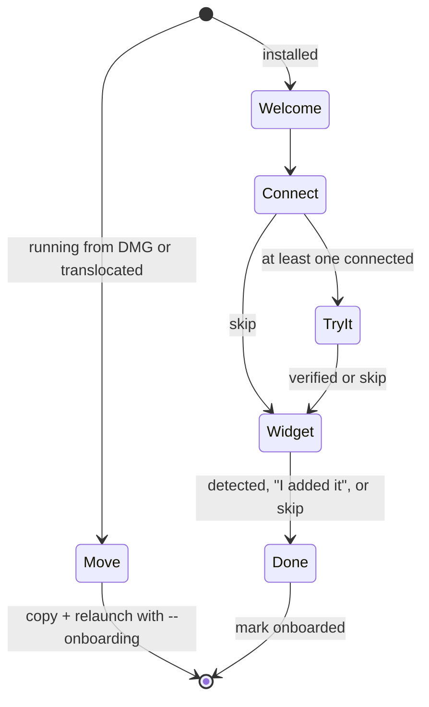
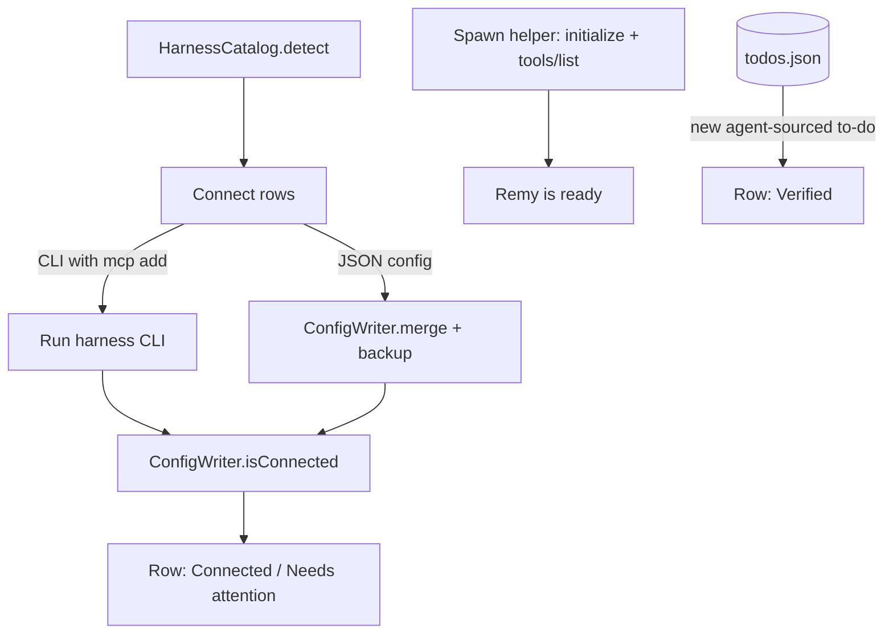

# feat: First-run onboarding and DMG packaging

## Summary

Turn Remy into an app a stranger can install from a DMG. On first launch, an onboarding window in the existing monochrome design moves the app into Applications if needed, then walks five steps. It detects installed agent harnesses and connects them with one click. It verifies each connection, both with a local self-test and a live "ask your agent" check. It guides the user to add the desktop widget and notices when they do. It ends on a short "how it works". A script builds the DMG.

---

## Problem Frame

Today, connecting an agent means pasting terminal commands from the popover. That worked for the author because an engineer wired up seven configs by hand. A consumer won't. They need to see which of their tools Remy found, flip them on, and get proof each one works before they trust it. The widget is the product's centerpiece, but macOS hides "Edit Widgets" behind a right-click. Installs from a DMG also start translocated (run from a temporary quarantine location) or on a mounted volume, so any config written from there would point at a path that soon disappears.

---

## Requirements

**Install**

- R1. When Remy runs from a mounted DMG or an App Translocation path, onboarding offers "Move to Applications". Accepting copies the app there, relaunches, and continues onboarding.
- R2. Onboarding opens automatically on first launch, and from the popover's menu at any time later.

**Detect and connect**

- R3. Detect these harnesses: Claude Code, Codex, Gemini CLI, opencode, Claude Desktop, Cursor, Windsurf, VS Code (Copilot), and LM Studio. CLIs are found through the user's login-shell PATH plus common install dirs. Apps are found by bundle or config presence.
- R4. Each detected harness shows its icon (the real app icon for GUI apps, a terminal glyph for CLIs), its name, and a status: Not connected, Connecting, Connected, Needs attention.
- R5. "Connect all" (default) and per-row toggles register Remy's MCP server using each harness's own mechanism. CLIs with an `mcp add` command use it. Everything else gets a JSON merge that preserves other keys and writes a one-time backup.
- R6. If a config can't be safely edited (unparseable JSON such as JSONC with comments, or a write failure), the row shows Needs attention with a "Copy setup" fallback and leaves the file untouched.
- R7. Configs point at the helper's absolute path inside the installed bundle. On every launch, Remy repairs entries that point at a stale Remy path.

**Verify**

- R8. Remy self-tests its own MCP server by spawning it and completing initialize and tools/list, showing the result as a single "Remy is ready" line.
- R9. The Try It step shows a copyable prompt ("Use Remy to add 'Try Remy' to my to-dos for today."). It waits for an agent-sourced to-do to arrive, then marks the matching harness row Verified with the to-do's title. Skipping is allowed.

**Widget**

- R10. The widget step shows a live preview of the real widget rendering the user's actual to-dos, plus clear steps to add it ("Right-click the desktop → Edit Widgets → search Remy").
- R11. Remy polls placed widget configurations and checks the step off when the widget appears. "I added it" and "Skip" are always available, because the API can be stale.

**Finish**

- R12. The Done step shows three example phrases, notes that future-dated to-dos appear on their day, and asks for notification permission in context.
- R13. The popover's copy-paste Connect panel is replaced by "Connect agents…", which opens onboarding at the Connect step.

**Distribution**

- R14. A single script builds a Release archive, exports it (Developer ID when a Developer ID identity is available, development signing otherwise), and produces `Remy.dmg` with an Applications shortcut. It notarizes and staples when a notary profile is configured.

**Design**

- R15. Onboarding follows `docs/design/visual-spec.md`: monochrome, SF Pro, hairline separators, red only for errors, named springs, and Reduce Motion fallbacks.

---

## Key Technical Decisions

- **Harness catalog and config writers live in RemyKit.** Detection, JSON merge, backup, and stale-path repair are pure and file-based, so they're testable against a temporary home directory without the UI.
- **Use the harness's own CLI when it has one.** `claude mcp add --scope user` and `codex mcp add` own their config formats (Claude's JSON with many keys, Codex's TOML). We only hand-edit plain JSON formats.
- **JSON merge refuses what it can't round-trip.** If `JSONSerialization` fails, for example on comments, Remy doesn't edit the file. It writes `<file>.remy-backup` once, before the first edit.
- **PATH comes from the login shell.** GUI apps get a minimal PATH, so Remy runs `$SHELL -lc 'printf %s "$PATH"'` once, with a 3-second timeout. It unions the result with `~/.local/bin`, `/opt/homebrew/bin`, `/usr/local/bin`, `~/.bun/bin`, `~/.opencode/bin` and `~/.npm-global/bin`, then searches for binaries.
- **Live verification keys on the to-do's source.** The MCP `clientInfo.name` already becomes the to-do's source. The mapping is extended to distinct names (Claude Code, Claude, Codex, Cursor, Gemini, Windsurf, opencode, VS Code, LM Studio) by keyword match, so the arriving to-do can light the right row. Any new agent-sourced to-do completes the step even if no row matches.
- **The real widget renders in the app.** `Widget/WidgetViews.swift`, `Widget/Provider.swift` and `Widget/ToggleTodoIntent.swift` are also compiled into the app target (the Snapshots target already does this). The preview is the actual widget, not a mockup.
- **Onboarding is an AppKit-hosted window.** It's a titled window with a transparent, full-size titlebar, hosting SwiftUI. The app switches to `.regular` activation policy while it's open, so it shows in the Dock and Cmd-Tab, and back to `.accessory` when it closes.
- **Move to Applications copies then relaunches.** It doesn't move. Remy copies the bundle to `/Applications` (falling back to `~/Applications` without admin rights), removes the quarantine attribute from the copy, launches it with `--onboarding`, and quits.
- **DMG uses only built-in tools.** `xcodebuild archive`/`-exportArchive`, `hdiutil`, `xcrun notarytool`/`stapler`. No new dependencies.

---

## High-Level Technical Design

Onboarding flow:



How a connection is made and checked:



---

## Output Structure

```text
Packages/RemyKit/Sources/RemyKit/Harness.swift          catalog, detection, config merge, repair
Packages/RemyKit/Tests/RemyKitTests/HarnessTests.swift
App/Onboarding/OnboardingWindow.swift                   window + activation policy
App/Onboarding/OnboardingModel.swift                    step state, detection, connect, verify
App/Onboarding/OnboardingView.swift                     shell: progress, transitions
App/Onboarding/Steps.swift                              Move, Welcome, Connect, TryIt, Widget, Done
App/Onboarding/Installer.swift                          move-to-Applications, self-test, shell PATH
scripts/make-dmg.sh
```

---

## Implementation Units

### U1. Harness catalog, detection, and config writer (RemyKit)

**Goal:** Pure logic that knows each harness, finds it, connects it via JSON, checks connection state, and repairs stale paths.

**Requirements:** R3, R5, R6, R7

**Dependencies:** none

**Files:** `Packages/RemyKit/Sources/RemyKit/Harness.swift`, `Packages/RemyKit/Tests/RemyKitTests/HarnessTests.swift`, `Packages/RemyKit/Sources/RemyKit/CLI.swift` (source-name mapping), `Packages/RemyKit/Tests/RemyKitTests/CLITests.swift`

**Approach:**
- `Harness` has an ID, a name, a kind (`cli(binary, addArgs)` or `json(path, key, entryStyle)`), an optional app bundle ID for the icon, and keywords for source matching.
- Entry styles: `mcpServers` (command + args), `vscode` (`servers` with `type: stdio`), and `opencode` (`mcp` with `type: local` and a command array).
- `detect(home:, searchPaths:, fileExists:, appInstalled:)` returns the detected harnesses. A JSON harness counts as detected if its config directory exists or its app is installed.
- `merge(into:, harness:, helperPath:)` returns the new file contents or throws `unparseable`. `isConnected` reads back the entry. `repair` rewrites entries whose command ends in `Contents/Helpers/remy` but differs from the current helper path.
- `CLI.sourceName` maps by keyword to distinct display names. `Theme.symbol` keeps working off those names.

**Test scenarios:**
- Happy path: merging into Cursor-style `{"mcpServers":{"other":{...}}}` adds `remy` and keeps `other` byte-equivalent after a JSON round-trip.
- Happy path: VS Code style writes `servers.remy.type == "stdio"`, and opencode writes `mcp.remy.command == [path, "mcp"]` with `enabled: true`.
- Edge case: a missing file creates `{key: {remy: ...}}`. An empty file is treated as `{}`.
- Error path: a file with `// comment` throws `unparseable` and stays unchanged on disk.
- Edge case: repair rewrites `/Volumes/Remy/Remy.app/Contents/Helpers/remy` to the new path. It leaves `/usr/local/bin/remy` (a user's custom path) and entries that aren't Remy's alone.
- Happy path: with fake search paths containing `claude` and a fake `~/.cursor/`, detect returns Claude Code and Cursor, but not Codex.
- Happy path: source names map "claude-code" to "Claude Code", "claude-ai" to "Claude", "Visual Studio Code" to "VS Code", "cursor-vscode" to "Cursor", and unknown names pass through.

**Verification:** `swift test` passes, including the new suite.

### U2. Installer: shell PATH, move-to-Applications, self-test, connect runner

**Goal:** App-side effects for detection and connection: run harness CLIs, apply JSON merges, self-test the MCP helper, relocate the app, and repair on launch.

**Requirements:** R1, R5, R6, R7, R8

**Dependencies:** U1

**Files:** `App/Onboarding/Installer.swift`, `App/RemyApp.swift` (repair on launch, `--onboarding` flag)

**Approach:**
- `loginShellPATH()` uses `Process` with a 3-second timeout, falling back to defaults.
- `connect(harness)`: CLI kinds run `<binary> mcp add …` (removing any prior `remy` entry first, so it's idempotent). JSON kinds read, merge, back up once, and write atomically. The result is `.connected`, `.failed(message)`, or `.needsManual(snippet)`.
- `selfTest()` spawns `Contents/Helpers/remy mcp` and sends initialize, initialized, and tools/list. It succeeds when 6 tools come back within 5 seconds.
- `isRunningFromTemporaryLocation` checks whether the bundle path contains `/AppTranslocation/` or starts with `/Volumes/`. `moveToApplications()` uses `FileManager` copy, removes `com.apple.quarantine` via `removexattr`, opens the new copy with `--onboarding`, then terminates.
- On launch, run repair over every JSON harness and re-run `mcp add` for CLI harnesses whose recorded path is stale.

**Test scenarios:**
- Test expectation: the process and file effects are integration-checked manually (connect against real configs on this Mac). The decision logic is unit-tested in U1. The path-classification function is pure and lives in RemyKit with a test: `/Volumes/Remy/Remy.app` is temporary, `/private/var/folders/.../AppTranslocation/.../Remy.app` is temporary, `/Applications/Remy.app` isn't.

**Verification:** The self-test passes for the installed app. Connecting Cursor in a temporary HOME writes the expected file.

### U3. Onboarding window, model, and shell

**Goal:** The window, step machine, and visual shell that every step plugs into.

**Requirements:** R2, R15

**Dependencies:** U2

**Files:** `App/Onboarding/OnboardingWindow.swift`, `App/Onboarding/OnboardingModel.swift`, `App/Onboarding/OnboardingView.swift`, `App/RemyApp.swift`, `App/StatusItemController.swift`

**Approach:**
- An `@Observable` model holds the steps, the harness rows, the self-test state, the verified source, the widget-detected flag, and an `onboarded` flag in `UserDefaults`.
- The window is 600×460, with a transparent titlebar and full-size content. It's centered, and switches the activation policy while open.
- The shell has a step title (22 semibold), a secondary subtitle, a content slot, and a footer with progress dots on the left and Back/Continue on the right. Steps transition by pushing horizontally on the `settle` spring, or a cross-fade under Reduce Motion.

**Test scenarios:**
- Test expectation: the step order logic is pure and covered with the flow in U1's suite. For example, `nextStep(from: .connect, connectedCount: 0)` gives `.widget`, and with 1 connected gives `.tryIt`. That function is placed in RemyKit as `OnboardingFlow`.

**Verification:** First launch with `onboarded` unset opens the window, and closing it marks onboarding done.

### U4. Welcome, Move, and Connect steps

**Goal:** The first three screens, including one-click connect with live statuses.

**Requirements:** R1, R3, R4, R5, R6, R8

**Dependencies:** U3

**Files:** `App/Onboarding/Steps.swift`

**Approach:**
- **Welcome:** the app glyph, "Meet Remy", and one line of value. The self-test runs here in the background.
- **Move:** shown only when the app is running from a temporary location.
- **Connect:** rows separated by hairlines, with the icon, name, a secondary detail ("Command line" or "App"), and a trailing status or toggle. The primary button is "Connect all" and changes to "Continue". Each row's status pops in with the `pop` spring. Needs-attention rows show a "Copy setup" link. If nothing is detected, show an empty state with the generic JSON snippet.

**Test scenarios:**
- Test expectation: visual. Snapshot renders with no harnesses, mixed states, and all connected, in light and dark.

**Verification:** On this Mac, all already-connected harnesses show Connected, and toggling one off and on round-trips its config.

### U5. Try It (live verification)

**Goal:** Prove the loop end to end with the user's own agent.

**Requirements:** R9

**Dependencies:** U4

**Files:** `App/Onboarding/Steps.swift`, `App/Onboarding/OnboardingModel.swift`

**Approach:**
- Show the prompt in a copyable well. Below it is a waiting line with a small progress indicator ("Waiting for your agent…").
- The model observes `AppController.todos` for a to-do created after the step opened whose source isn't "you" or "cli". On arrival, the row matching the source keywords shows "Verified", and the to-do's title appears with the check-off pop.

**Test scenarios:**
- Test expectation: the matching function (source to harness ID) is covered in U1. The step itself is verified manually by running a real `claude -p` or CLI add while the step is open.

**Verification:** Adding a to-do via MCP from Claude Code while the step is open marks Claude Code Verified within a second.

### U6. Widget step

**Goal:** Get the widget onto the desktop with a live preview and detection.

**Requirements:** R10, R11

**Dependencies:** U3

**Files:** `App/Onboarding/Steps.swift`, `project.yml` (widget view sources added to the app target), `Widget/Provider.swift`

**Approach:**
- The preview renders `WidgetBody(.systemMedium)` from the current store, inside a widget-shaped rounded rect on a soft desktop backdrop.
- Three numbered instructions follow. While the step is visible, a 1-second poll of `WidgetCenter.shared.getCurrentConfigurations` checks for any entry of kind `RemyWidget`. On detection, the preview gets a check badge and Continue becomes primary. "I added it" and "Skip" are available.

**Test scenarios:**
- Test expectation: visual plus manual. Detection is verified by adding the widget on this Mac while the step is open.

**Verification:** The preview shows the real to-dos, and placing the widget flips the step.

### U7. Done step and entry points

**Goal:** Close the loop and replace the old Connect panel.

**Requirements:** R12, R13

**Dependencies:** U4, U6

**Files:** `App/Onboarding/Steps.swift`, `App/UI/PopoverRoot.swift`, `App/UI/SetupPanel.swift` (deleted), `App/AppController.swift`

**Approach:**
- **Done:** "You're set", three example phrases in quiet wells, and one sentence on future-dated to-dos. Notification permission is requested on "Finish", not at app launch.
- The popover's ellipsis becomes a menu: "Connect agents…" and "Quit Remy". Notification authorization moves out of `AppController.start()` into onboarding's Finish, or happens on start once the user is already onboarded.

**Test scenarios:**
- Test expectation: visual. Snapshot renders of every step.

**Verification:** Finishing onboarding asks for notifications once. "Connect agents…" reopens the Connect step.

### U8. DMG packaging

**Goal:** One command produces a distributable DMG.

**Requirements:** R14

**Dependencies:** none

**Files:** `scripts/make-dmg.sh`, `scripts/ExportOptions-developer-id.plist`, `scripts/ExportOptions-development.plist`, `README.md`

**Approach:**
- The script runs XcodeGen, `xcodebuild archive`, then export. It uses the Developer ID method when `security find-identity` shows a "Developer ID Application" identity for the team, and development otherwise, with a loud warning.
- It stages the app plus an `/Applications` symlink and runs `hdiutil create -format UDZO`. If `REMY_NOTARY_PROFILE` is set, it runs `notarytool submit --wait`, then `stapler staple` on the DMG.

**Test scenarios:**
- Test expectation: none. This is a build script, verified by running it and mounting the DMG.

**Verification:** `build/Remy.dmg` mounts, shows Remy.app next to the Applications shortcut, and the app inside launches into the Move step.

---

## Scope Boundaries

### Deferred to Follow-Up Work

- Zed (JSONC settings), Goose (YAML), and Amp. These need format-aware editors.
- An auto-update feed (Sparkle) and a custom DMG background art.
- Notarized public release. This needs a paid Apple Developer ID on the user's team.

---

## Risks & Dependencies

| Risk | Mitigation |
|---|---|
| No Developer ID on the user's team, so Gatekeeper blocks other users | The script signs and notarizes only when credentials exist. The README documents what's needed |
| `getCurrentConfigurations` returns stale results | "I added it" and Skip are always available |
| Harness config formats drift | CLIs own their formats via `mcp add`. JSON formats are isolated in one catalog, and unparseable files are never touched |
| The login shell PATH call hangs (heavy `.zshrc`) | `-l` without `-i`, a 3-second timeout, and common-dir fallback |
| Writing other apps' configs surprises users | One-time backups, explicit "Connect all" button, per-row toggles |

---

## Sources & Research

- Widget detection: [getCurrentConfigurations](https://developer.apple.com/tutorials/data/documentation/widgetkit/widgetcenter/getcurrentconfigurations(_:).md), and a [stale-results report](https://developer.apple.com/forums/thread/661838)
- VS Code MCP format: [MCP configuration reference](https://code.visualstudio.com/docs/copilot/reference/mcp-configuration). The user config is assumed to be at `~/Library/Application Support/Code/User/mcp.json`.
- Existing config shapes come from this Mac's live configs, written in the previous session: Cursor, Claude Desktop, Gemini, Windsurf, and opencode.
